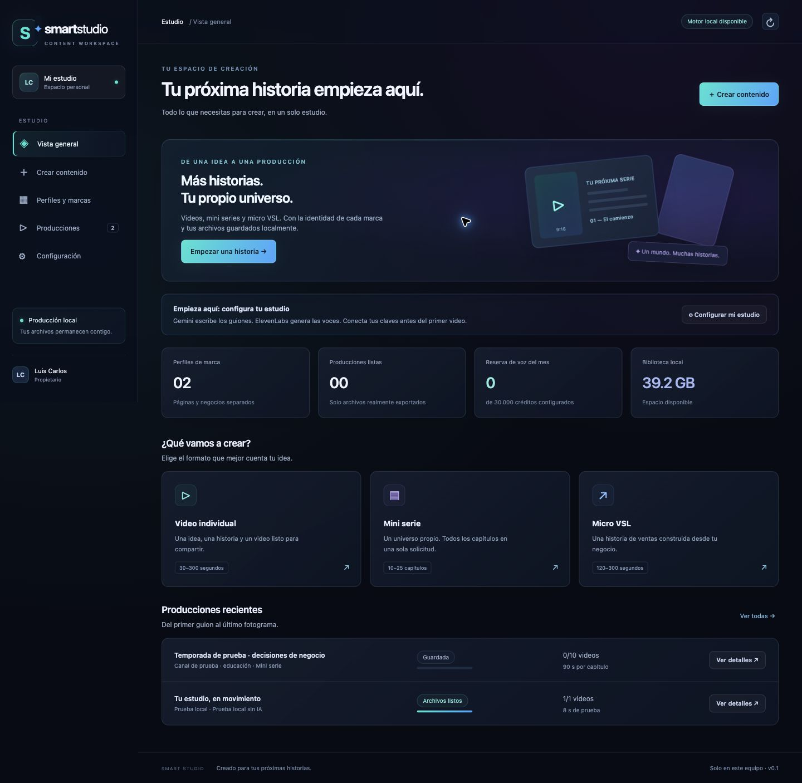

# Smart Video Studio

Aplicación interna para automatizar la producción de videos, mini series y micro VSL. La aplicación vigente produce y guarda los medios en el Mac. La conexión y las pruebas reales de Gemini y ElevenLabs ya se realizaron; el panel remoto para Vercel continúa pendiente de adaptación.

**Empieza por la [guía paso a paso](docs/INICIO_PASO_A_PASO.md).** Explica dónde están los archivos, cómo abrir la aplicación, dónde está Configuración y de dónde obtener la clave de Gemini.

## Qué hay en este repositorio

| Ubicación | Contenido |
|---|---|
| [`estudio-local/`](estudio-local/) | Aplicación vigente: interfaz, servicio local, SQLite, planificador, integración de voz y primer renderizador |
| [`estudio-local/coordinador-n8n.json`](estudio-local/coordinador-n8n.json) | Copia del nuevo coordinador n8n; ya existe en la instancia del propietario |
| [`plataforma/`](plataforma/) | Prototipo anterior basado en Sites/D1. Se conserva como antecedente; no es el punto de inicio actual |
| Archivos Markdown de la raíz | Análisis de recursos, repositorios y propuestas; describen también decisiones anteriores |

Los videos, imágenes de producción, bases locales, claves y cachés no se suben a GitHub.

## Abrir la versión actual

En el equipo donde se está desarrollando, abrir con doble clic `estudio-local/Iniciar Smart Studio.command`. Mantener abierta la ventana que inicia el servicio y entrar a `http://127.0.0.1:4317/`.

En una copia nueva del repositorio, se necesitan Node.js 22.13 o posterior y FFmpeg/ffprobe. Dentro de `estudio-local`, ejecutar `npm ci` y luego `npm start`.

**Configuración está dentro de Smart Studio**, en el menú lateral izquierdo, junto al icono de engranaje. No es la configuración de Codex, GitHub o n8n.

## Estado real

Comprobado: perfiles, claves persistentes, voces en español, presupuestos y consumo conciliado, generación de guiones, audio ElevenLabs y exportación MP4 local. Incluye logo opcional, referencias visuales, imágenes de producción, modos de texto creativo/literal y láminas estáticas con PNG, música cargada y narración opcional. Se han exportado videos reales con voz y logo.

El modo 2D importa recursos originales mediante una [integración inicial de CODE ART](docs/CODE_ART_LOCAL.md), con un catálogo acotado de objetos y salida 1080×1920/60 fps.

En movimiento se animan imágenes propias o imágenes generadas por escena. Las poesías se producen como imágenes completas con texto mediante Nano Banana o GPT Image 2, con movimiento opcional. La integración tiene pruebas de contrato, caché, cuotas y exportación; las pruebas visuales reales dependen del acceso y cuota de las cuentas de imágenes. Facebook/Instagram, personajes 2D avanzados y la conexión segura de una UI remota con el Mac siguen pendientes.

La interfaz utiliza la dirección visual recuperada de Smart Growth Online / Synapse: fondo azul noche, paneles glass y acentos teal, azul eléctrico y violeta. Los valores de implementación y su origen están en [Diseño](docs/DISENO.md). El acabado se seguirá revisando con el propietario.

## Despliegue posterior

Subdominio elegido: `creativestudio`. Los DNS se administran en IONOS. Vercel es la opción elegida para el panel. El repositorio ya se importó allí, pero el motor local no está adaptado para funcionar como servicio remoto; un despliegue exitoso no resuelve esa conexión. El subdominio elegido es `creativestudio` sobre el dominio registrado en IONOS.

GitHub almacena y versiona el código. Netlify/Vercel alojarían el panel. El Mac y el disco seleccionado producen y conservan los medios. Subir el código no publica la aplicación ni convierte el motor local en un servidor remoto.

## Comprobar el código

Desde `estudio-local`: `npm test`. Consultar el [README técnico y sus limitaciones](estudio-local/README.md) antes de una ejecución pagada.
