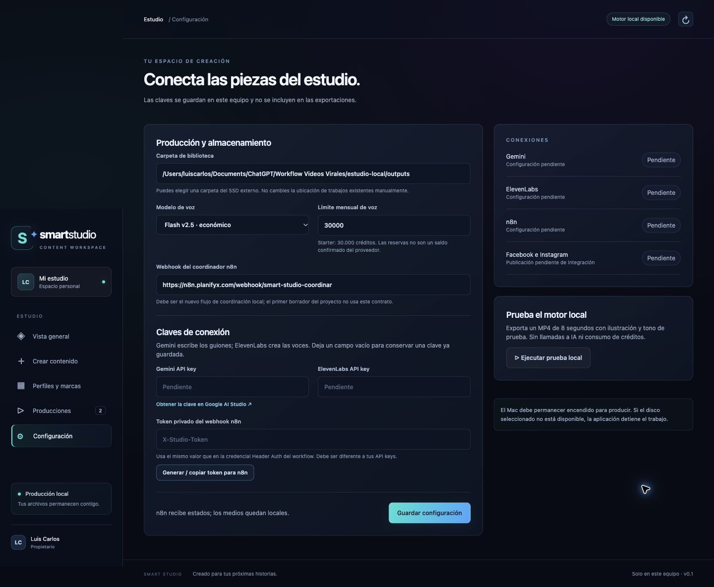

# Inicio paso a paso

## 1. Dónde están guardadas las cosas

En el Mac de desarrollo, la carpeta del proyecto es:

```text
/Users/luiscarlos/Documents/ChatGPT/Workflow Videos Virales/
```

La aplicación que debes abrir está dentro de `estudio-local`. La carpeta `plataforma` es un prototipo anterior; no debes iniciarla para estos pasos.

Dentro de `estudio-local`:

- `public/`: lo que ves en el navegador.
- `server.mjs`, `planner.mjs`, `render.mjs`: el servicio y la producción.
- `.state/`: datos y claves locales; no se sube a GitHub.
- `outputs/`: biblioteca de prueba y videos; no se sube a GitHub. Después puedes elegir otra carpeta o un SSD externo desde la aplicación.

GitHub contiene una copia del código, no tus datos locales ni videos. No hay un despliegue Netlify o Vercel confirmado.

## 2. Cómo abrir la aplicación en este Mac

1. Abre **Finder**.
2. Presiona **Command + Shift + G** para abrir «Ir a la carpeta».
3. Pega esta dirección y pulsa Enter:

   ```text
   /Users/luiscarlos/Documents/ChatGPT/Workflow Videos Virales/estudio-local/
   ```

4. Haz doble clic en **Iniciar Smart Studio.command**.
5. Se abrirá una ventana de Terminal que mantiene el servicio funcionando. Déjala abierta. Si ya hay un motor abierto, el acceso comprueba su versión: reutiliza la actual o reinicia una versión anterior cuando no hay producciones en curso. Si hay una producción activa, espera a que termine o páusala antes de actualizar.
6. El navegador debería abrir Smart Studio. Si no lo hace, entra en:

   ```text
   http://127.0.0.1:4317/
   ```

Esa dirección solo funciona en el equipo que está ejecutando la aplicación. Si aparece «No se puede acceder a este sitio», comprueba que la ventana iniciada en el paso 4 siga abierta y no muestre un error.

## 3. Dónde está Configuración

Dentro de la página **Smart Studio**, mira el menú vertical del lado izquierdo:

1. Vista general.
2. Crear contenido.
3. Perfiles y marcas.
4. Producciones.
5. Consumo y costos.
6. **Configuración**, junto al engranaje **⚙**.

Haz clic en **Configuración**. También hay un botón visible **Configurar mi estudio** en la página de inicio mientras falten conexiones. En una pantalla estrecha, el menú aparece arriba y puede desplazarse horizontalmente.

Allí están «Carpeta de biblioteca», «Webhook del coordinador n8n» y la sección **Claves de conexión**, con los campos **Gemini API key** y **ElevenLabs API key**. No son pantallas de Codex ni de n8n.



## 4. Para qué se necesita Gemini y cómo obtener su clave

Gemini es la propuesta inicial para escribir fichas de personajes, plan de temporada, guiones y textos de publicación. ElevenLabs genera las voces. Son proveedores distintos. No se creó una cuenta de Google ni una clave de Gemini en tu nombre.

1. Abre [Google AI Studio](https://aistudio.google.com/apikey) e inicia sesión con tu cuenta de Google.
2. Si es la primera visita, completa personalmente los avisos y condiciones de Google.
3. En la página de claves, busca **Create API key / Crear clave de API**. Google puede haber creado ya un proyecto y una clave inicial para una cuenta nueva.
4. Si te pide elegir un proyecto, selecciona uno propio o crea uno para **Smart Video Studio**.
5. Copia la clave y vuelve a la aplicación local, a **Configuración → Claves de conexión → Gemini API key**.
6. Pégala allí y pulsa **Guardar configuración**, al final del formulario.

La interfaz de Google puede mostrar nombres distintos según idioma y cuenta. Su [guía oficial de claves](https://ai.google.dev/gemini-api/docs/api-key) explica creación, proyectos y permisos.

Crear la clave y activar facturación son pasos distintos. La disponibilidad de cuota gratuita depende del modelo y de tu cuenta; no se debe asumir que una temporada completa será gratuita. No es necesario activar un plan pagado para localizar la clave. Si Google exige facturación para el modelo elegido, revisaremos el presupuesto antes de hacer una prueba pagada.

No pegues la clave en el chat, en un archivo del repositorio ni en el código de la interfaz.

## 5. Dónde poner ElevenLabs

En la misma página de Smart Studio, pega tu clave existente en **ElevenLabs API key** y guarda. Tu plan informado es Starter, con 30.000 créditos mensuales.

Después entra en **Perfiles y marcas**, crea o elige un perfil y pulsa **Elegir voz**. La aplicación consultará las voces de tu cuenta y podrás asignar una al narrador del perfil. Guardar una clave o seleccionar una voz no genera un audio pagado.

## 6. Conectar el workflow correcto de n8n

El nuevo workflow es [Smart Studio · 00 Coordinación local](https://n8n.planifyx.com/workflow/W0Yov0Nebhvtaa1M). El anterior «Serie · 01 Planificar temporada completa» se conserva como antecedente y no es el que debe usarse en esta aplicación local.

1. En Smart Studio, abre **Configuración** y pulsa **Generar / copiar token para n8n**. El token de entrada es distinto de tus API keys.
2. Abre el workflow enlazado arriba en n8n.
3. Abre su nodo **Estado desde el Mac**.
4. En autenticación, debe aparecer **Header Auth**. Crea o selecciona una credencial con nombre de cabecera **X-Studio-Token** y pega en el valor el token que copiaste desde Smart Studio.
5. Guarda la credencial y el workflow. Después publica el workflow.
6. En Smart Studio, la dirección de producción debe ser:

   ```text
   https://n8n.planifyx.com/webhook/smart-studio-coordinar
   ```

7. Guarda la configuración local.

El workflow está desactivado hasta completar la credencial y publicarlo. Su prueba manual comprobó la lógica de la siguiente etapa; no equivalió a conectar tus proveedores ni a producir un video pagado.

## 7. Primera prueba real

1. Completa un perfil con la temática, audiencia e información real del negocio.
2. Asigna la voz del perfil.
3. Para imágenes con movimiento, añade imágenes propias con **+ Imagen**. La plantilla 2D inicial todavía es básica.
4. En **Crear contenido**, elige **Video individual**, duración objetivo de **90 segundos** y un límite de créditos.
5. Guarda. En **Producciones**, abre **Ver detalles** y pulsa **Producir**.

Esta acción sí utiliza las APIs configuradas. La producción pagada completa todavía debe probarse. Primero se validará un video, después una VSL y luego una temporada.

## 8. Diseño y alojamiento

El diseño visual está en revisión según las preferencias de Smart Growth Online. El objetivo es una interfaz premium con paneles glass y acentos neón; las acciones y estados deben seguir siendo fáciles de leer.

Guardar en GitHub es el paso actual. Después de revisar la UI y validar el primer video, conectaremos el alojamiento elegido y el subdominio propuesto `studio.smartgowth.online`. No hace falta cambiar de proveedor DNS: los registros siguen en IONOS.

Antes del despliegue remoto hay que resolver login y conexión del panel con el motor del Mac. Una subida estática a Netlify o Vercel por sí sola no resuelve esa comunicación.

## 9. Consumo y costos

Abre **Consumo y costos** en el menú izquierdo. El panel muestra:

- Consumo mensual del estudio: créditos de ElevenLabs confirmados o estimados y tokens de Gemini reportados por la API (entrada, salida y razonamiento).
- Consumo de cada producción: incluye planificación, guiones y revisiones de la temporada completa. Las llamadas fallidas con consumo reportado también se registran.
- Reservas de voz pendientes, separadas del consumo. Las reservas conservadoras siguen controlando el presupuesto; no se sustituyen por el nuevo contador.
- Tabla de estimaciones de voz para 45, 60, 90, 120, 150, 180, 240 y 300 segundos. Parte de 150 palabras/minuto y 6 caracteres por palabra con espacios, ajustables. No garantiza una duración exacta.

Pulsa **Actualizar saldo de ElevenLabs** para consultar el saldo de la cuenta, incluido el uso fuera de Smart Studio. Requiere permiso de lectura de suscripción en la API key. La consulta no genera audio. Se muestra fecha de consulta y renovación si el proveedor la informa. No se consulta en cada actualización automática de la interfaz.

En **Tarifas y supuestos**, introduce tus tarifas en USD. Para repartir el precio de la suscripción: importe efectivamente pagado / créditos incluidos × 1.000. Ese costo asignado no equivale a un cargo extra por cada video. Para Gemini, introduce tarifa por millón de tokens de entrada y de salida/razonamiento del modelo utilizado; no se asumen tarifas gratuitas ni precios universales. El cálculo de entrada es conservador y no aplica descuentos de caché. Cambiar tarifas recalcula el historial; actualízalas si cambias de modelo o plan.

ElevenLabs informa el cargo por solicitud en la cabecera `character-cost`; si falta, el panel identifica la parte estimada. Los tokens de Gemini se registran desde `usageMetadata`, incluidos los de razonamiento. No existe aquí un saldo universal de tokens de Gemini: el panel mide el uso de esta aplicación, no la facturación completa de Google Cloud. La tabla por segundos estima voz; Gemini depende también del contexto del negocio, continuidad y revisiones. No es fiable deducirlo únicamente de la duración.

El historial real comienza con esta actualización. Las reservas antiguas se conservan y no se presentan como consumo confirmado. El mes local es calendario en Guatemala; la suscripción del proveedor puede tener otro ciclo. No se hicieron generaciones pagadas para verificar este panel.

Referencias: [consumo y tokens de Gemini](https://ai.google.dev/gemini-api/docs/generate-content/tokens), [respuesta y costo de ElevenLabs](https://elevenlabs.io/docs/api-reference/introduction/), [saldo de suscripción](https://elevenlabs.io/docs/api-reference/user/subscription/get).

Los perfiles sirven para negocios, páginas y canales de entretenimiento, educación y monetización por visualizaciones. El campo **Información del negocio, página o canal** permite describir propósito, temas, tono y objetivos.

## 10. Las conexiones se conservan

Después de guardar, cada clave muestra **Guardada en este equipo** en lugar de volver a mostrar su valor. No necesitas introducirla otra vez al abrir la aplicación. Pulsa **Cambiar** únicamente cuando quieras sustituirla; dejar el campo vacío conserva la anterior.

El token de n8n también muestra su estado guardado, independientemente de si ya introdujiste la URL del workflow. **Copiar token guardado para n8n** recupera el mismo token: no lo regenera. Si sustituyes manualmente el token con **Cambiar**, actualiza también la credencial de n8n.

## 11. Voces en español y español latino

En **Perfiles y marcas → Elegir voz**, se abre la biblioteca de ElevenLabs con **Español latino** seleccionado. Puedes cambiar a **Todo el español**, elegir un país o seleccionar **Mis voces** para ver únicamente las que ya están en tu cuenta. Usa **Consultar más voces** para continuar la búsqueda: el catálogo tiene varias páginas.

Los filtros usan etiquetas y variantes verificadas de ElevenLabs; una voz sin metadatos de acento latino no se presenta como latina. El acento final depende de la voz y el modelo. La consulta excluye voces de tarifa especial. Seleccionar **Añadir y asignar voz** añade esa voz a tu colección y la asigna al perfil, sujeto a permisos y espacios del plan. Esta acción no genera audio. Si la voz ya estaba añadida, puedes elegirla desde **Mis voces**.

Referencia: [biblioteca de voces](https://elevenlabs.io/docs/api-reference/voices/voice-library/get-shared).

## 12. Tarjetas, logo y referencias por producción

Los perfiles se muestran en tarjetas compactas de igual altura, con la voz y su botón en la parte superior. **Ver ficha** conserva el acceso a toda la temática, audiencia e información del negocio, página o canal; los textos no se recortan en la base local.

En **Crear contenido**, activa **Incluir logo de marca en este video** y adjunta un PNG. El logo se ajusta proporcionalmente dentro de 180 × 140 píxeles en una composición de 1080 × 1920, con un margen de 40 píxeles arriba y a la derecha. Permanece fijo incluso sobre imágenes con movimiento. Si no activas la opción, no se incrusta. En una serie se aplica a todos sus capítulos.

Puedes adjuntar hasta veinte **Imágenes de referencia**, PNG/JPG/WebP, de hasta 16 MB por archivo. Se almacenan localmente. Al producir se envían versiones reducidas a Gemini para orientar guiones y composición; ese análisis consume tokens. No se ha integrado un generador de imágenes: las referencias orientan el contenido y no garantizan una reproducción de su diseño. Solo se usa la primera como fondo si activas esa opción; en otro caso permanecen como referencias de planificación.

Para cartas y poesía, selecciona **Lámina estática · carta o poesía**. Puedes pegar tu texto original, que se mostrará y narrará; o dejarlo vacío para crear un texto original a partir del tema. El formato mantiene una lámina fija con texto legible, sin los subtítulos móviles del resto de formatos. Conserva párrafos y adapta el tamaño del texto; si no cabe con un tamaño legible, solicita dividirlo en varios videos en lugar de omitir palabras. En series, deja el texto vacío para obtener un texto propio por capítulo. La duración final depende del audio generado.

## 13. Confirmar que la voz quedó guardada

Después de elegir una voz, pulsa **Guardar voz para este perfil**. La aplicación confirma el guardado y muestra el nombre de la voz en la tarjeta. Al abrir de nuevo el selector también aparece **Voz actual del perfil**. Si la voz de biblioteca ya se añadió a tu cuenta, se reutiliza su identificador guardado sin intentar añadirla otra vez. El guardado se conserva al reiniciar; no genera audio.

Cada imagen adjunta tiene un botón **Quitar**. También puedes usar **Quitar todas**; estas acciones conservan el texto y las demás opciones del formulario. El contador muestra cuántas referencias seleccionaste (máximo 20). Más referencias implican mayor consumo de tokens al producir.
